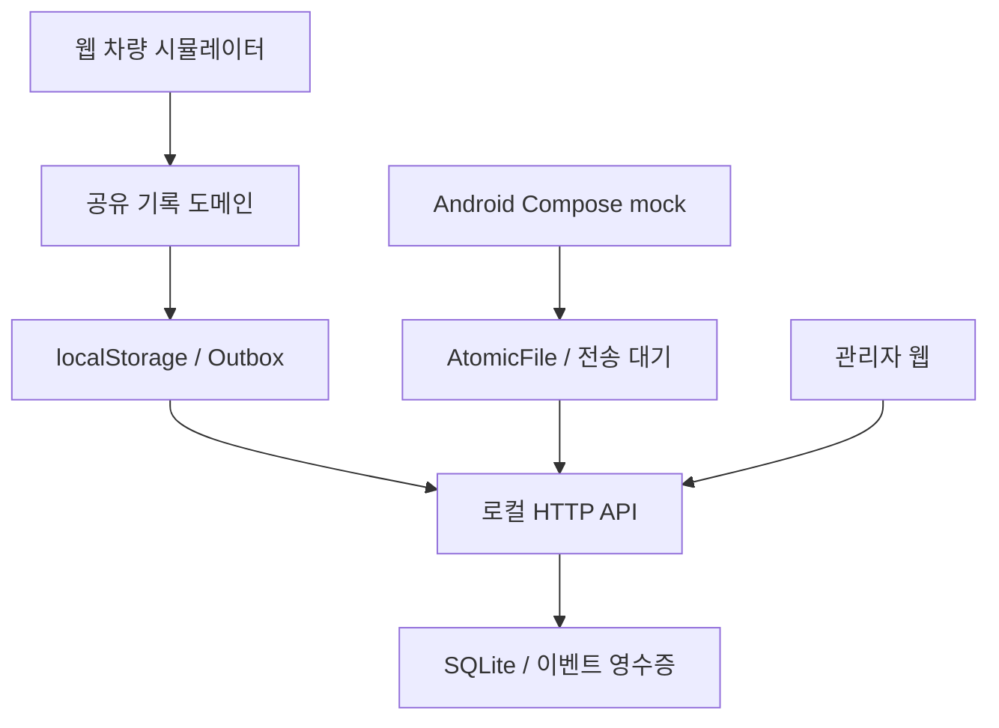
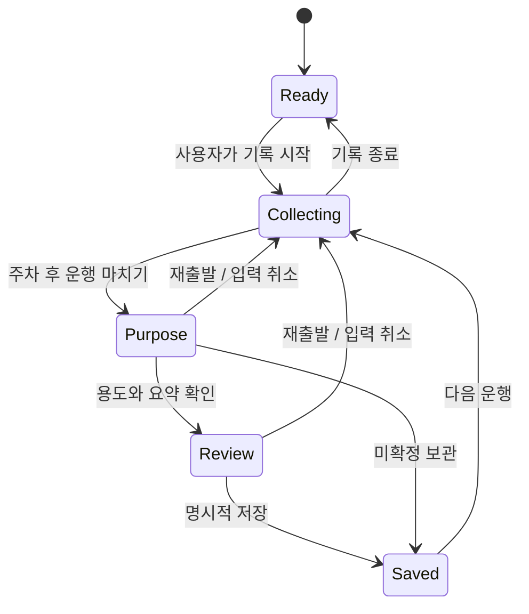

# 시스템 구조와 데이터 경계

## QR 연결 MVP의 별도 경계

`npm run demo:mvp`는 `scripts/demo-mvp.mjs` → `services/mvp/server.mjs` → 새 임시 `mvp.sqlite`로 실행합니다. `/mvp/car`, `/mvp/driver`, `/mvp/admin`, `/mvp/control`은 같은 서버의 `/mvp-api/` 상태를 약1초 간격으로 조회합니다. 데모 회사1·직원2·차량2와 QR 토큰/연결 이력, MVP 대화·모의 수집·전송 대기·수신 기록을 저장하며 아래의 기존 운행 API·SQLite·Outbox와 섞지 않습니다.

`apps/web/src/main.tsx`는 MVP 경로에서 운행 controller 생성·writer lock 획득을 건너뜁니다. 기존 경로의 Web Lock은 유지합니다. 직원 선택의 새 MVP 브라우저 키는 계정 선호값일 뿐이며 연결 상태의 출처는 서버입니다. 원자적인 일회용 토큰 소비·연결·해제와 세대 검증은 서버 저장소가 담당합니다. QR URL과 모바일 입력용 연결 코드는 같은 발급 건을 가리키고 서버 시각 기준 10분 뒤 함께 만료됩니다. 어느 한 방식의 연결이 확정되면 둘 다 소비되며, 차량 화면의 연결 확인 버튼은 GET 재조회만 수행합니다. 최초 구현의 경계는 [MVP_STEP1_QR.md](MVP_STEP1_QR.md), 최신 규칙은 [차량 UI 변경 기록](MVP_VEHICLE_UI_UPDATE.md)을 참고하세요.

MVP의 `workflow.mjs`는 연결별 차량 상태·수집 세션·운행·대화·prompt claim·고정 운전자 귀속을 관리합니다. 명시적인 QR/코드 연결은 모의 수집 대기 상태를 만들지만 운행이나 목적 질문을 생성하지 않습니다. ‘모의 출발’에서 운행을 시작하고, ‘모의 도착’은 주차 상태와 마지막 관측 시각·누적거리만 반영합니다. 차량의 ‘운행 마치기’에서 종료 후보를 고정하고 목적 질문을 생성합니다. 음성 동의 또는 미확정 보관 시 종료 원본과 준비된 이벤트 문자열을 수집 대기 테이블에 함께 저장합니다.

`RuntimeControl`의 자동 uploader가 실제 `/mvp-api/trip-events`로 전송하면 수신 운행·영수증·수신 상태를 한 트랜잭션으로 반영합니다. 관리자 수신 목록은 이 수신 테이블만 사용합니다. 수집과 수신은 같은 격리 DB 안의 별도 테이블이며 장치 오프라인 저장소로 표현하지 않습니다. 업로드 차단 중에는 기록이 전송 대기에 남으며 QR·조회·모의 제어는 계속 동작합니다.

음성 재생은 시연 패널의 browser speech port 한 곳에서만 요청하고 prompt의 서버 단일 claim으로 중복을 막습니다. 실제 음성인식은 없습니다. 안내 완료·모의 답변·재확인·명시적 동의를 분리하며, 무응답·보류·실패도 미확정 기록으로 보존합니다. 질문/확인 중 재출발하거나 ‘계속 운행’을 누르면 종료 후보와 초안을 취소하고 같은 운행을 유지합니다. 새 대화 세대와 운행·연결 식별자를 검증해 이전 단계의 늦은 명령을 무시합니다.

차량 화면은 `VehicleScreen.tsx`·`vehicle.css`의 실제 HTML/CSS이며 주차 중 QR 또는 기록 대기·운행 확인 화면을 표시합니다. 주행 중에는 콘텐츠와 조작을 비우고, 상태 불명확 시 주차 확인 배지와 종료 조작을 제공하지 않습니다. 음성 진행 중에도 같은 운행 화면을 유지하고 모의 발화·실패 조작은 별도 시연 패널에 둡니다.

‘기록 종료’는 차량 연결 해제와 별개입니다. 관측된 미완료 구간만 미확정 보관한 뒤 세션을 중지하며, 빈 운행이나 미관측 거리·시각을 만들지 않습니다. 새로고침과 기존 연결 재조회는 중지 상태를 바꾸지 않습니다. 다시 기록하려면 주차 중 명시적으로 ‘기록 시작’을 눌러야 합니다. 이전 MVP2의 ‘연결 후 항상 빈 화면·출발 전 질문·도착 즉시 확정’은 최신 요구로 대체했습니다. [MVP2 당시 기록](MVP_STEP2_VOICE_TRIP.md)은 이력으로 보존하며 현재 동작·검증은 [차량 UI 변경 기록](MVP_VEHICLE_UI_UPDATE.md)을 따릅니다.

### 모바일 보완·월별 자료·모의 접수

`MvpStore`가 `MvpWorkflow` 뒤에 `services/mvp/reporting.mjs`의 `MvpReporting`을 구성합니다. 같은 **격리 MVP DB**에 `mvp_amendments`, `mvp_reporting_requests`, `mvp_costs`, `mvp_reports`, `mvp_submissions`, `mvp_reporting_settings`를 추가하며 기존 개발 DB와 일반 `/api/` 계약·스키마는 바꾸지 않습니다.

서버 수신 원본·준비된 업로드 문자열·운행 ACK는 불변입니다. 미확정 수신 운행의 원래 직원만 목적지·용도·상세 목적을 보완하고, 별도 이력의 `amendmentVersion`으로 최신 표시값을 만듭니다. 최초 수신 `serverVersion:1`과 보완 버전은 다릅니다. 요청 ID와 예상 보완 버전을 트랜잭션 안에서 검사해 중복 이력·동시 덮어쓰기를 막습니다. 해제된 연결의 원래 직원도 보완할 수 있으며, 현재 연결이 있다면 주차 확인이 필요합니다. 최초 업로드를 재전송해도 보완 표시값은 되돌아가지 않습니다.

`AmendmentEditor`는 계정·운행별 입력을 유지하고, 계정 변경/이탈 시 요청을 취소하며 세대로 늦은 응답 반영을 차단합니다. 현재 운행이 주행/불명확 상태이면 입력을 막습니다. 보완 저장 실패는 입력과 동일 요청 ID를 유지하며 충돌은 최신 조회 후 확인하도록 안내합니다. 관리자 목록·상세·확인 필요는 공통 서버 조회의 최신 표시본을 사용하고, 알려진 업로드 대기는 실제 수신본과 분리합니다.

`MonthlyReports`는 목록 필터와 독립된 월을 선택합니다. 서버는 회사 전체·전체 차량의 **운행 시작 시각을 한국 날짜로 분류한 수신본**을 집계하고 품질 불완전 거리를 제외합니다. 목적 미확정은 별도 용도 그룹입니다. 비용은 날짜가 고정된 소수의 `dummy-fixture`이며 다른 월에 복제하거나 운행 ACK를 지출 영수증으로 사용하지 않습니다.

자료 생성은 운행 ID·보완 버전·직원/차량 마스터·비용·집계·확인 사유를 고정한 `mvp_reports` 스냅샷을 만듭니다. 화면과 CSV는 같은 스냅샷을 읽습니다. 현재 월의 입력 fingerprint가 달라지면 갱신 필요를 별도로 계산하고, 과거 스냅샷을 덮어쓰지 않습니다. CSV는 UTF-8 BOM·정상 인용·수식 접두 처리로 생성하며 외부 PDF/엑셀 도구는 사용하지 않습니다.

모의 제출은 별도 `mvp_submissions`의 접수·시도 기록입니다. 준비 조건을 서버에서 재검사하고, `processing`을 저장한 뒤 서버 시각의 약 1초 경과와 결과 조회에 따라 `completed`/`failed`를 영속 반영합니다. 클라이언트 타이머의 가짜 성공이나 외부 신고가 아닙니다. 중복 제출은 접수를 늘리지 않고 실패 재시도만 새 시도를 추가합니다. `DEMO-` 접수번호·과거 결과는 이후 원본 변경에도 유지하며 갱신 필요 상태와 구분합니다.

시연 패널의 ‘월말 처리 재현’은 관리자와 동일한 자료 생성 API를 호출하고 모의 실패/성공 모드는 다음 접수 시도에만 적용됩니다. 차량 화면·운행 엔진·음성 합성 adapter·자동 uploader는 기존 구현을 재사용합니다. 상세 경로/DTO는 [API 계약](API.md#격리-mvp-api--보완월별-자료모의-접수), 최종 실행·시연·제한은 [MVP 인수인계](MVP_FINAL_HANDOFF.md)에 있습니다.

## 런타임 구조

아래 구조와 상태 전이는 기존 개발 화면·Android의 운행 계약을 설명합니다. 위 MVP는 별도 임시 DB와 API를 사용하며 기존 클라이언트의 저장·음성 절차를 변경하지 않습니다.

실제 제품의 차량 클라이언트 후보는 Android이다. 웹 시뮬레이터는 화면·프로세스·프로토콜 실험을 위한 개발 도구다. 브라우저 운행값은 mock이며 실차 SDK와 연결되지 않는다. 두 클라이언트는 같은 wire 계약을 사용하지만 reducer나 영속 저장 엔진을 공유하지 않는다.

## 웹 상태 전이

- 운행 마치기: 종료 후보 시각·거리 고정. 이후 용도 입력 지연이 종료시각을 늘리지 않는다.
- 재출발: 초안·종료 후보를 취소하고 같은 구간의 수집을 이어 간다.
- 목적 보류: purpose=null인 기록과 Outbox를 같은 로컬 저장에 반영한다.
- 저장 후: 수집 세션은 유지되며 다음 주행에 새 tripId가 생긴다.
- 기록 종료: 수집 세션을 끝내고 양수 거리의 미완료 구간을 미확정 보관한다. 다시 시작하려면 버튼을 눌러야 한다.
- 재실행: 중간 구간은 gap으로 보관한다. 앱이 닫힌 동안의 누락 거리는 복원했다고 주장하지 않는다.
- 최종 목적은 운전자 확인값이다. 모의 음성 결과는 수정 가능한 초안만 만든다.

웹 음성은 `VoiceFlow` → `VoiceAdapter` port → mock adapter로 분리한다. VoiceFlow는 sessionId/tripId·현재 입력 초안을 검증하는 메모리 상태이며, 운행 저장은 기존 FleetController만 수행한다. 중간 결과는 미리보기, 최종 결과는 수정 가능한 초안이다. 실제 SDK는 연결하지 않았다. 상세 상태·취소·교체 조건은 [3단계 흐름](STEP3_FLOW.md)을 참고한다.

## Outbox와 버전

1. 비즈니스 payload, eventId, localRevision을 로컬 기록과 함께 저장한다.
2. 선행 변경이 있으면 그 ACK를 기다린다.
3. 최초 전송 직전에 expectedServerVersion을 넣어 preparedEvent를 영속 저장한다.
4. 네트워크 전송과 ACK 검증 후에만 해당 eventId를 Outbox에서 제거한다.
5. 응답 유실 시 같은 preparedEvent를 재전송한다. 서버는 기존 ACK를 돌려준다.
6. 409는 충돌로 보류한다. 후속 리비전도 자동 전송하지 않는다. 충돌 해소 UI는 후속 과제다.

5단계에서 영속 ACK 반영과 네트워크 오류 처리를 분리했다. ACK를 받았어도 로컬 commit에 실패하면 영수증·완료 리비전을 갱신하지 않고 같은 preparedEvent를 유지한다. 이 저장 실패는 메모리의 `syncError`와 예외로 알린다. `inFlightEventId`는 실제 요청 하나만 가리키는 메모리 값이며 재실행 시 전송 중으로 복원하지 않는다.

연결/시간 초과/408/429/5xx는 queued로 남겨 수동 재시도한다. 409는 conflict, 그 밖의 4xx 및 성공 응답의 잘못된 JSON은 blocked로 보류한다. 각 운행의 후행 변경은 실제 선행 영수증이 있어야 준비하며, 다른 운행의 전송은 계속할 수 있다. 로컬 schemaVersion 1에 오류 상태/사유만 추가했고 wire 계약은 유지했다. 기존 v1은 변경 없이 읽으며 내부 구조 손상은 자동 복구·삭제 대신 원문 보존과 시작 차단으로 처리한다. 상세 규칙과 검증은 [5단계 기록](STEP5_RELIABILITY.md)을 참고한다.

원본 시각·거리·quality는 서버에서 변경 불가다. purpose와 note 보완만 허용한다. 이 스타터는 기간별 누적거리 대조·감사 로그 조회·승인 시스템을 구현하지 않는다.

## 저장과 신뢰

브라우저는 Web Locks로 문서 수명 동안 writer를 하나로 제한한다. 저장 직전 원문 비교는 잘못된 오래된 인스턴스의 덮어쓰기를 추가 차단한다. 이는 여러 장치의 동시 수정 해결책이 아니다.

SQLite는 trip 변경과 이벤트 ACK 저장을 하나의 트랜잭션으로 처리한다. 실제 사용자 인증 대신 고정 mock 바인딩과 개발 헤더를 사용한다. 개발 헤더는 비밀값이나 인증 토큰이 아니다.

일반 PC 브라우저 저장소는 실제 차량 데이터의 영구 보관 장치가 아니다. 제품화 시 암호화 저장, 장치 등록·철회, tenant 권한, 키 관리, 서버 백업, 보존/삭제 정책을 별도 설계해야 한다.

## 이번 버전의 클라이언트 차이

| 동작 | 웹 시뮬레이터 | Android scaffold |
|---|---|---|
| 확정·미확정 생성/전송 | 구현 | 구현·JUnit/HTTP/빌드 통과, Android 화면 미검증 |
| 기존 목적 보완 리비전 | 구현 | 구현·선행 ACK 이후 준비, Kotlin 검증 통과 |
| 409 충돌 | 충돌 상태로 보류·후행 전송 차단 | conflict/blocked 보류·후행 차단, 다른 운행 전송 |
| 수집 세션 중단 | 관측된 운행을 목적 미확정 보관 | 마지막 관측 구간을 미확정/gap 보관 |
| 재실행 | 마지막 관측 구간 gap, 수집 중단 | 마지막 관측 구간 gap, 수집 중단·주차 UNKNOWN |
| 음성 | 지연/실패를 포함한 모의 초안 | 안내 완료·인식·중간/최종·취소를 분리한 mock 초안 |

Native 보완 기능을 변경할 때에는 공통 Outbox 계약과 Android의 영속 저장·동시성·수명주기를 함께 검토한다. 브라우저에서 생성한 기록과 Android에서 생성한 기록은 각 기기의 로컬 저장소가 별도이므로 웹 차량 탭에서 Native 기록을 편집할 수 없다.

6단계 Android는 기존 파일명을 유지한 v2→v3 마이그레이션과 AtomicFile 스냅샷을 사용한다. 실제 ViewModel과 JVM 테스트가 `OutboxSynchronizer`를 공유하며 네트워크 동안 저장 mutex를 해제한다. 기본 APP_MOCK 기록과 선택적 `src/pleos/` SDK 진단은 분리했다. SDK 관측은 현재 mock 전송 계약에 넣지 않으며 실서비스 수신도 확인하지 못했다. [6단계 결과](STEP6_ANDROID_PLEOS.md)에서 컴파일·JVM·에뮬레이터·실 SDK 검증 범위를 구분한다.
