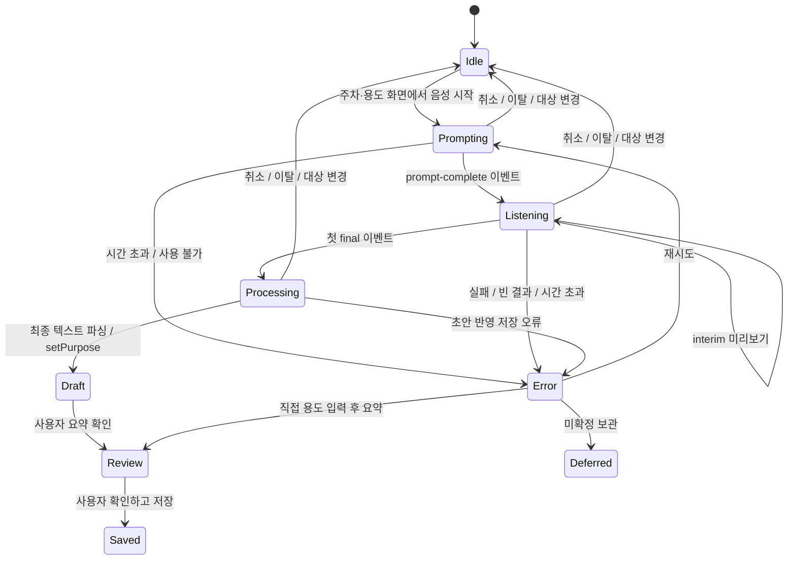

# Fleetlog · 3단계 기록·음성 입력 흐름

작업일: 2026-11-15 KST. 대상은 웹 시뮬레이터입니다. 2단계의 차량 화면 구조·브랜드·관리자 동작을 유지하고, 음성 작업을 교체 가능한 mock adapter와 임시 입력 세션 관리자로 분리했습니다. 실제 마이크·음성 서비스·Pleos SDK·외부 AI·유료 API는 연결하지 않았습니다.

## 변경 파일과 경계

| 파일 | 역할 |
|---|---|
| `packages/domain/voice-adapter.d.mts` | 앱 내부 음성 port: context, 이벤트, 안내/인식 수명주기 타입 |
| `packages/domain/voice-flow.mjs`, `.d.mts` | controller의 현재 운행·초안을 확인하는 일시적 음성 상태 관리자. 녹음·운행 저장 기능 없음 |
| `packages/domain/voice-text.mjs`, `.d.mts` | 최종 문장에서 명확한 용도와 발화에 포함된 메모만 분리 |
| `apps/web/src/voice/mock-adapter.mjs`, `.d.mts` | 안내 완료·중간·최종·정상 종료·오류를 전달하는 개발용 adapter |
| `apps/web/src/voice/useVoiceInput.ts` | React 구독, 화면·문서·창 활성 상태와 해제 연결 |
| `apps/web/src/App.tsx`, `styles.css` | 음성 안내/듣기/처리/초안/오류 표시와 개발용 결과 제어. 기존 네이비·청록 화면 유지 |
| `tests/voice-*.test.mjs`, `tests/record-flow.test.mjs` | 제어 가능한 시간·이벤트로 세션 경계와 기록 불변 검증 |

기존 `FleetController` runtime, API 계약, 저장소 키·데이터 형식, Outbox와 Web Lock은 유지했습니다. Android는 별도 클라이언트이며 이번 웹 음성 코드를 사용하지 않습니다.

## 상태 전이와 사용자 저장



- 안내는 `startPrompt()`로 시작하고, **안내 완료 이벤트를 받은 뒤에만** `startRecognition()`을 호출합니다. mock도 별도 작업입니다. 실제 소리는 출력하지 않습니다.
- 중간 결과는 화면 미리보기만 변경합니다. controller 초안·기록·Outbox에 반영하지 않습니다.
- 첫 최종 결과에서 인식을 정상 종료하고, 별도 제어 가능한 0ms 작업에서 결과를 처리합니다. 처리 대기 중에도 취소할 수 있습니다. 이 짧은 상태가 모든 기기에서 육안으로 보이는 것을 보장하지 않습니다.
- 최종 결과는 `controller.setPurpose()`로 수정 가능한 초안만 만듭니다. 사용자가 `review()` → `save()`를 실행해야 기록이 생깁니다. 미확정 보관은 기존 `defer()`를 사용합니다.
- 오류·빈 결과·시간 초과·사용 불가에서도 일반 용도/메모 입력, 재시도, 미확정 보관을 제공합니다. 안내 제한은 10초, 듣기 제한은 15초인 **웹 mock 설정**입니다. 실제 SDK의 제한을 나타내지 않습니다.

## 최종 문장 처리

| 최종 문장 | 용도 후보 | 메모 초안 |
|---|---|---|
| 일반 업무, 거래처 미팅 | `business` | 거래처 미팅 |
| 출퇴근 | `commute` | 빈 문자열 |
| 개인 용도, 장보기 | `personal` | 장보기 |
| 거래처 미팅 | 미선택 | 거래처 미팅 |
| 일반 업무 또는 개인 용도 | 미선택 | 빈 문자열 |

원문은 ‘인식한 문장 · 모의 결과’로 보여 줍니다. 명확한 한 가지 선두 용도만 선택하고, 복수·부정·불확실한 표현이나 문장 중간의 용도 언급은 사용자 선택을 요구합니다. 메모가 120자를 넘으면 임의로 자르지 않고 원문을 보여 주며 직접 입력하게 합니다. 발화에 없던 내용을 생성하지 않습니다.

이는 제한된 정규식 mock parser이며 한국어 자연어 이해 모델이 아닙니다. 예를 들어 메모 부분의 부정까지 용도 불확실로 처리할 수 있습니다. 용도 미선택 상태에서는 요약 확인이 비활성화됩니다. 원문 표시·중간 결과·음성 세션은 메모리 상태이며 별도 필드로 저장·전송하지 않습니다. 변환한 purpose/note 초안은 기존 controller의 임시 입력 상태로 로컬 저장소에 반영되지만, 운행 기록과 Outbox는 명시적 저장/미확정 보관 후에 생성됩니다. 원음 파일은 생성·저장하지 않습니다.

## 취소·늦은 결과·중복 규칙

모든 작업과 이벤트에 `sessionId`, 대상 `tripId`를 연결합니다. 이벤트의 두 식별자와 현재 작업 객체, 현재 controller 상태, 작업 시작 당시 초안이 모두 일치해야 결과를 받을 수 있습니다.

| 상황 | 처리 |
|---|---|
| 주행 전환 | controller가 입력 초안·종료 후보 취소. 음성 작업도 취소 |
| 입력 취소·다른 운행 편집·입력 화면 이탈 | 작업 무효화 후 adapter 안내/인식 중단 |
| 수집 세션 종료 또는 종료 확인창 | 음성 작업 취소. 실제 종료는 기존 `stop()` |
| 관리자 탭 전환·문서 숨김·창 focus 상실·pagehide | `setForeground(false)`로 즉시 무효화. 돌아와도 자동 재시작 없음 |
| 새 음성 작업 | 이전 작업을 먼저 무효화하고 새 식별자 발급 |
| 직접 초안 수정 | 실행 중 작업의 초안 스냅샷과 달라지면 취소. 이전 결과가 직접 입력을 덮어쓰지 않음 |
| 중복 최종 이벤트·최종 이후 중간/오류 | 첫 최종 결과만 소비. 이후 콜백 무시 |
| adapter가 취소 후에도 콜백 전달 | 정리 호출 **전에** 작업을 무효화하므로 재진입·늦은 콜백도 무시 |

React effect 재연결에서도 사용 가능하도록 `disconnect()`는 진행 중 작업과 타이머를 정리하며 adapter를 영구 dispose하지 않습니다. 새 작업은 다시 사용자가 시작해야 합니다. 실제 adapter도 취소 후 늦은 콜백이 올 수 있다는 전제로 구현해야 합니다.

## 기록 불변과 저장 실패

- 음성 시작·처리·수동 수정은 `finish()`를 다시 호출하지 않습니다. 최초 종료 후보 시각·거리로 확인·저장합니다.
- 재출발하면 기존 controller 규칙으로 같은 운행의 수집을 이어 갑니다. 취소된 후보를 음성 결과로 복원하지 않습니다.
- 미확정 저장은 purpose=null 기록과 Outbox를 함께 만듭니다. 용도 보완은 같은 tripId에서 purpose/note만 수정하며 원본 시각·거리·quality를 유지합니다. gap을 정상 거리로 바꾸지 않습니다.
- 초안 반영 또는 최종 저장이 실패하면 오류를 표시하고 해당 입력 상태를 유지합니다. 저장 성공 화면은 controller의 실제 저장 성공 후에만 표시합니다.
- 두 번째 연속 `save()`/`defer()` 호출은 현재 상태 검사에서 거부됩니다. 같은 운행·Outbox가 추가 생성되지 않습니다. UI의 저장 클릭과 동일한 controller 호출을 자동 테스트했습니다. 실제 브라우저 연속 클릭 검증은 아래 제한에 포함됩니다.
- 로컬 저장과 실제 ACK는 기존 별도 상태입니다. 음성 완료가 서버 수신 완료를 뜻하지 않습니다.

## 실행과 검증

```sh
npm ci
npm run dev
npm run check
```

본 앱은 `http://127.0.0.1:5173`, 기존 데이터에 영향 없는 메모리 전용 검증 화면은 `http://127.0.0.1:5173/qa/`입니다. 주행→주차→운행 마치기 후 ‘음성으로 입력’을 누릅니다. 안내가 끝나면 개발용 제어의 ‘중간 결과 전달’, ‘최종 결과 전달’을 사용합니다. 모의 문장과 정상/실패/빈 결과/시간 초과/사용 불가는 **음성 시작 전** 선택합니다. 인식 시작 당시 설정을 고정하므로 도중 설정 변경은 다음 작업에 적용됩니다.

`npm run check`에서 **92/92 테스트 통과**, 실패·skip 0이며 TypeScript 검사와 Vite 웹 빌드도 통과했습니다. 기존 57개에 adapter/parser 8개, 음성 상태·오염 방지 20개, 실제 mock adapter 통합 4개, 기록 저장 경계 3개를 추가했습니다. 테스트는 실제 FleetController와 mock 또는 취소 후에도 콜백을 보내는 fake adapter를 연결합니다. 안내·인식·처리 타이머와 기록 시계는 주입해 실제 음성 서비스나 긴 대기에 의존하지 않습니다.

정상 최종 결과의 대상 초안 반영, 중간 결과 비저장, 모호한 용도 선택 요구, 취소·재출발·이탈·세션 종료·다른 운행 이후 늦은 결과 무시, 직접 수정 보호, 중복 콜백·연속 저장, 오류·시간 초과 후 수동/보류/재시도, 종료 후보 고정, 저장 실패 복구, 실제 ACK 전후 경계를 검증했습니다. effect 재연결에 쓰는 flow/adapter 재사용과 타이머 해제도 검증했습니다. React StrictMode 자체의 브라우저 마운트 검증을 수행한 것은 아닙니다.

브라우저 검증은 이번 단계에서 완료하지 못했습니다. 브라우저 인벤토리가 `The browser access host is unavailable`을 반환했고, 실행 중인 Chrome에 대한 native 연결도 `js execution timed out; kernel reset`으로 실패했습니다. 정상·실패·취소·비활성화의 실제 DOM 클릭과 신규 음성 문구의 크기별 레이아웃은 미검증입니다. 2단계 Chrome 결과를 3단계 결과로 재사용하지 않습니다. 서버 렌더링 검사는 실행되지만 클릭·focus·visibilitychange·화면 배치를 대체하지 않습니다.

실행 로그와 작업 전 소스 목록·서버 수신본은 ignore 대상 `test-results/step3/`에 둡니다. 실제 브라우저 기록을 초기화하지 않았고, 이번 음성 검증은 메모리 저장소로 수행했습니다. HTTP 재조회로 기존 서버 수신본 4건의 전체 JSON이 작업 전과 같은지 확인했습니다. Android·API·계약·기록 controller runtime·관리자·의존성·잠금 등 보호 대상 39개 파일은 시작 시점 해시와 같습니다. 개발 서버의 본 앱·QA 응답은 모두 HTTP 200이며, 이는 브라우저 클릭 검증을 뜻하지 않습니다. 소스 manifest에 새 코드·테스트·문서를 반영하고 산출물·검증 데이터·SQLite는 제외했습니다.

## 실제 Pleos adapter 연결 지점과 조건

교체 지점은 `useVoiceInput.ts`의 adapter 생성과 앱 내부 `VoiceAdapter` port입니다. 이 port 메서드 이름은 공식 SDK의 API 이름을 뜻하지 않습니다. 현재 웹 mock을 실제 차량 앱과 연결했다고 표시하지 않습니다.

후속 연결 전 제공받은 공식 문서·샘플·계정 권한·대상 기기의 SDK 버전을 확인해야 합니다. 안내 완료 신호, 중간/최종/정상 종료의 의미와 순서, 사용 가능 상태, 취소·시간 초과·focus·백그라운드 수명주기를 검증한 뒤 이 port로 매핑합니다. 마이크·음성 관련 권한과 거부/철회 처리도 대상 환경에서 확인합니다. 실제 호출이나 권한 이름은 여기서 추정하지 않습니다.

mock/live 선택은 명시적인 구성으로만 허용하고, live가 사용 불가하면 수동 입력·미확정 보관으로 안내해야 합니다. live 실패를 mock 성공으로 자동 전환하면 안 됩니다. Android는 Kotlin 수명주기에 맞는 별도 adapter와 상태 검증이 필요합니다.

## 다음 4단계 관리자 웹 인수인계

1. 이번 단계에서 남은 실제 브라우저 정상·실패·취소·focus/숨김·재출발·중복 클릭 및 세 크기 검증을 먼저 완료합니다.
2. 관리자는 최종 수신 purpose/note와 원본 품질만 조회합니다. 음성 원문·중간 결과·음성 세션은 전송하지 않으므로 관리자에 인식 이력이나 음성 확신도를 표시할 근거가 없습니다.
3. 미확정과 gap을 별개로 설명하고, 보완 전 수신본과 새 리비전의 ACK 대기를 구분합니다. 관리자 승인·기간 마감·세무신고는 이번 ACK와 별도 미구현 상태입니다.
4. 버전 충돌의 조사·해소 정책과 감사 이력은 여전히 미구현입니다. 새 eventId 우회, 원본 덮어쓰기 없이 별도 설계합니다. API·저장 형식 변경이 필요하면 Android 계약도 함께 검토합니다.
